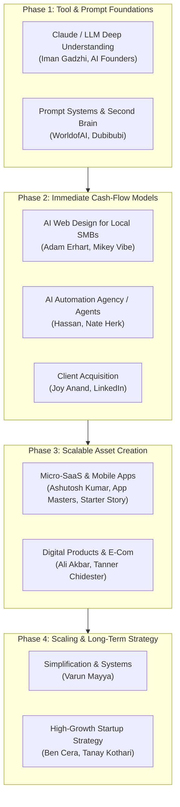

# M-NOW-1 Playlist: Comprehensive Breakdown, Categorization & Action Plan

**Playlist URL:** [https://youtube.com/playlist?list=PLM7V873Udr1g](https://youtube.com/playlist?list=PLM7V873Udr1g)  
**Total Videos Analyzed:** 56 Videos  
**Primary Theme:** AI-Powered Monetization, Micro-SaaS, Web Development, Automation Agencies & Entrepreneurship

---

## Executive Summary & System Flow

The videos in this playlist represent a complete spectrum of digital business models powered by AI (specifically Claude, ChatGPT, Gemini, and AI site builders). They range from immediate, low-barrier freelance work ($300–$2,000/mo) up to full-scale SaaS applications ($300k+ MRR).

---

## 1. Categorized Video Catalog

### Category 1: AI Web Design & Local Business Agency Services (9 Videos)
> **Core Concept:** Building high-conversion, aesthetic landing pages and business websites with zero or low code using Claude, ChatGPT, and modern AI builders, then monetizing them via recurring retainers or upfront packages ($297–$5,000+).

| # | Video Title | Creator / Channel | Direct Link | Key Focus / Takeaway |
|---|---|---|---|---|
| **12** | Build This Once → Sell It to Every Local Business ($297/Mo) | Adam Erhart | [Watch](https://www.youtube.com/watch?v=rgwR8qjbxRM) | The core recurring retainer model selling simple high-converting funnels to local SMBs. |
| **33** | 7 Local Business Websites You Can Build with AI and Sell This Week | Mikey Vibe Coding | [Watch](https://www.youtube.com/watch?v=XRWJ7S5Zf7g) | Specific niche templates (plumbing, dental, real estate, gyms) ready to pitch and sell immediately. |
| **14** | Build a Premium Animated Website for FREE with AI (0 Coding) | Darsh Jain | [Watch](https://www.youtube.com/watch?v=IEVGuYJ_2qY) | Creating interactive animations and modern UI without touching raw code. |
| **19** | Build AI Websites With ChatGPT In Minutes (Start Using For Free) | Darsh Jain | [Watch](https://www.youtube.com/watch?v=_-8EUek_nIM) | Quick prototyping of responsive website layouts using ChatGPT code generation. |
| **28** | $7000 Portfolio Website With Free AI Tools In 10 Minutes \|\| No Coding | Creativo | [Watch](https://www.youtube.com/watch?v=tf_yi6DtDOQ) | Designing high-end portfolio sites to position yourself as an expensive designer. |
| **37** | GPT-5.6 Sol Builds Insanely Beautiful Websites | Zubair Trabzada | [Watch](https://www.youtube.com/watch?v=kxs23pJ-CoQ) | Prompt-to-web workflows creating complex, design-grade landing pages. |
| **40** | Build $50,000 Websites Using Claude Fable 5 (Full Tutorial) | Viktor Oddy | [Watch](https://www.youtube.com/watch?v=5ZAsjUoMx1Y) | End-to-end tutorial on building enterprise-looking web applications using Claude. |
| **51** | Build & Publish an Automotive Business Website with AI | Profit Studio | [Watch](https://www.youtube.com/watch?v=G7V5UtrEpDg) | Niche case study: mechanics, detailing shops, and car dealers. |
| **29** | Award Winning Animated Websites through Figma Motion | AyzZ | [Watch](https://www.youtube.com/watch?v=E_6Z7EUSFu4) | Incorporating motion design and Figma assets into website builds to command 5x prices. |

---

### Category 2: Micro-SaaS, AI Tools & App Development (7 Videos)
> **Core Concept:** Leveraging LLMs as co-engineers to construct single-utility tools, mobile apps, and micro-SaaS platforms that run on subscription models or ad monetization.

| # | Video Title | Creator / Channel | Direct Link | Key Focus / Takeaway |
|---|---|---|---|---|
| **26** | 7 Tiny Apps Making ₹35 Lakh/Month — You Can Build These With AI | Ashutosh Kumar | [Watch](https://www.youtube.com/watch?v=Ecc3qeREvgY) | Breakdown of micro-utilities (PDF converters, resume builders, audio tools) making massive recurring revenue. |
| **9** | The NEW Way to Build Mobile Apps with Claude Code & Fable 5 | Build Great Products | [Watch](https://www.youtube.com/watch?v=UZYW8BnclvI) | Developing native-style mobile apps with Claude acting as the lead software engineer. |
| **49** | How She Built Two AI Apps to $300K MRR | App Masters | [Watch](https://www.youtube.com/watch?v=SdqUZGJM384) | Growth hacking, user acquisition, and paywall testing to scale apps to $300,000/month. |
| **39** | My App Made $120K in 24 Hours | Starter Story | [Watch](https://www.youtube.com/watch?v=DkmStHS8NP0) | Viral product launch mechanics, leveraging Product Hunt, Twitter/X, and PR for rapid validation. |
| **42** | He Went From Struggling to Make $1 to Turning Down $1M | Superwall | [Watch](https://www.youtube.com/watch?v=CtqEbgutSb4) | The importance of in-app monetization, paywalls, and pricing optimization for SaaS longevity. |
| **35** | How My STUPID Game Made $2,000,000 | The Greatest Developer | [Watch](https://www.youtube.com/watch?v=NA8gTa-GFro) | Viral loop design, gamification, and simple web/mobile games monetized via ads & purchases. |
| **4** | Claude Built this AI Tool and Monetize with Google Adsense | Saddam Kassim | [Watch](https://www.youtube.com/watch?v=yIHf-PAXk0g) | Building high-traffic free utility calculation tools and monetizing with programmatic display ads. |

---

### Category 3: AI Automation Agency (AAA), Lead Generation & High-Ticket B2B (5 Videos)
> **Core Concept:** Packaging AI automations (CRM integration, automated outbound, agentic workflows) for established businesses willing to pay $2,000–$10,000/project.

| # | Video Title | Creator / Channel | Direct Link | Key Focus / Takeaway |
|---|---|---|---|---|
| **50** | Build & Sell AI Agents + Automations (2+ Hour FREE Course) | Hassan \| AI Automations | [Watch](https://www.youtube.com/watch?v=UKCXhUzKaFo) | Complete masterclass: building agentic workflows (Make, n8n, LangChain/custom AI) and selling to clients. |
| **48** | How I’d Make Money with Claude if my life depended on it | Nate Herk \| AI Automation | [Watch](https://www.youtube.com/watch?v=vY0EzTP-7EA) | Realistic, step-by-step agency service offerings you can fulfill solely using Claude for B2B operations. |
| **32** | Claude + Google Maps = $17,000/month | Oliver Rasmussen | [Watch](https://www.youtube.com/watch?v=ZIB36wWdmos) | Scraping Google Maps local businesses, auditing their listings/sites with Claude, and sending automated cold audits. |
| **47** | How to Get $10,000 Clients on LinkedIn for SMMA in 2026 | The Joy Anand | [Watch](https://www.youtube.com/watch?v=2nqcZBx3tsM) | High-ticket B2B outreach strategy on LinkedIn targeting founders and marketing directors. |
| **15** | How to Earn ₹50,000/Month Selling UGC Ads (Beginner Guide 2026) | AI Lavishka | [Watch](https://www.youtube.com/watch?v=YRqUR36P-us) | Generating and selling UGC (User-Generated Content) style video ads using AI avatars and scriptwriters. |

---

### Category 4: Digital Products, E-Commerce & Creator Income (6 Videos)
> **Core Concept:** Building digital distribution channels through content, templates, online stores, and digital downloads that sell on autopilot.

| # | Video Title | Creator / Channel | Direct Link | Key Focus / Takeaway |
|---|---|---|---|---|
| **20** | Claude & Shopify Built $750k/m Ai Powered Ecom Brand! | Ali Akbar | [Watch](https://www.youtube.com/watch?v=z06laDSzT9M) | Full breakdown of white-label e-commerce, using AI for product research, copy, creatives, and CRO. |
| **45** | I Make $141 Million Selling These Simple Digital Products (Copy Me) | Tanner Chidester | [Watch](https://www.youtube.com/watch?v=dHpIKpEP9IA) | The high-ticket digital product playbook: packaging information, community, and coaching. |
| **3** | Week 1: Making Rs.50,00,000 In 100 Days By Selling Digital Products | Grow With Nitesh | [Watch](https://www.youtube.com/watch?v=I6q4Zj6Rd9o) | Indian market digital product selling (e-books, templates, checklists) via Meta ad campaigns. |
| **1** | I Earn $31K/Month with Gmail + Hostinger | TechnoMind Ujjwal | [Watch](https://www.youtube.com/watch?v=E5OgkWz_Jrw) | Affiliate marketing and niche blog flipping using email outreach and web hosting. |
| **10** | I Tested Letting Claude Start a YouTube Channel for 20 Minutes | Make Money Matt | [Watch](https://www.youtube.com/watch?v=NKNjbno2ucs) | Faceless YouTube automation: using AI for script generation, title/thumbnail ideation, and tags. |
| **46** | How I Made My First $50 on Whop Content Rewards Clipping | Unreal Ishan | [Watch](https://www.youtube.com/watch?v=kqKqEhoPxqA) | Short-form content clipping and creator reward programs on Whop for immediate beginner earnings. |

---

### Category 5: AI Prompting Mastery, LLM Workflows & Second Brain (6 Videos)
> **Core Concept:** Mastering the underlying engines (Claude, GPT, Gemini) so you can build, write, and think 10x faster than competitors.

| # | Video Title | Creator / Channel | Direct Link | Key Focus / Takeaway |
|---|---|---|---|---|
| **2** | ⁠Give Me 26 minutes, I'll Give You 10,000 hours of Claude Knowledge | Iman Gadzhi | [Watch](https://www.youtube.com/watch?v=wtDDjBOfTZo) | Mental models for prompting Claude: context windows, tone calibration, persona framing, and artifact use. |
| **27** | You're Using 10% of Claude. This Only Takes 13 Minutes To Learn | AI Founders | [Watch](https://www.youtube.com/watch?v=Uy3tqFxJFi8) | Advanced prompting techniques, multi-step chain-of-thought, and system prompts for high-precision output. |
| **6** | I Scraped 85,000 Claude Skills. These Are The Most Popular | Dubibubi | [Watch](https://www.youtube.com/watch?v=1GgyJfCK608) | Data-driven analysis of what users actually build with Claude skills/custom instructions. |
| **25** | Turning Claude Fable 5 Into The Ultimate Second Brain! | WorldofAI | [Watch](https://www.youtube.com/watch?v=DYdC-oqLMiY) | Building a persistent knowledge management system and memory architecture with Claude. |
| **34** | Opus 5 Just Destroyed a 1.9 Billion Dollar SEO Tool | Nico \| AI Ranking | [Watch](https://www.youtube.com/watch?v=pGEil0yuW1A) | Using Claude for programmatic SEO, keyword clustering, search intent analysis, and content silos. |
| **36** | Gemini Spark Isn’t Just Another AI Coworker (Free Prompt) | The Tech Girl | [Watch](https://www.youtube.com/watch?v=GPK10dFn8ew) | Specialized system prompts for structured business research, competitive intelligence, and drafting. |

---

### Category 6: Founder Mindset, Startup Scaling & Macro Trends (6 Videos)
> **Core Concept:** Strategic lessons from founders running 7, 8, and 9-figure enterprises on team building, spending, paid media, and operational simplicity.

| # | Video Title | Creator / Channel | Direct Link | Key Focus / Takeaway |
|---|---|---|---|---|
| **21** | How Simplifying Everything Makes You Rich | Varun Mayya | [Watch](https://www.youtube.com/watch?v=0tbeJZYvsg4) | Essentialism in business: why reducing features, offers, and complexity creates massive leverage. |
| **8** | 2027-2030 Business Cheat Codes - AI Agents & Money Multiplication | Ranveer Allahbadia (TRS) | [Watch](https://www.youtube.com/watch?v=6PbBne1x2is) | Macro discussion on upcoming technology shifts, autonomous agent workforces, and capital allocation. |
| **24** | I Built a $250M AI Company. The Bill is $1M a Month | Ben Cera | [Watch](https://www.youtube.com/watch?v=bzf2YZa0Vkg) | The raw economics of scaling an AI infrastructure business: server costs, GPU allocation, and margins. |
| **53** | This Is What Running a $2B AI Startup Looks Like | Tanay Kothari | [Watch](https://www.youtube.com/watch?v=fhs7voB2eJQ) | Leadership, speed of shipping, and organizational dynamics inside a hyper-growth unicorn. |
| **54** | Raw footage from CEO Ep 1 - I spent ₹14 Crores on Meta Ads | Deep Shah | [Watch](https://www.youtube.com/watch?v=Ih9AD3rtba8) | Real performance marketing breakdown: scaling Meta ad spend profitably, creative fatigue, and ROAS. |
| **41** | Meet the Internet's Richest 16 Year Olds ($101,294/mo) | Champ | [Watch](https://www.youtube.com/watch?v=9ZtSRgKJOPc) | Modern internet hustle culture, viral brand incubation, and community monetization. |

---

### Category 7: Free Tools, API Workarounds, Remote Jobs & Outliers (17 Videos)
> **Core Concept:** Tactical hacks for getting free model access, discovery of niche tools, online micro-jobs, and off-topic playlist entries.

#### Sub-group A: Free Credits & API Hacks (Evaluate Critically)
*Note: These often rely on temporary promo codes, community proxies, or affiliate bypasses.*
* **#5:** [Claude Opus 4.8 FREE + ChatGPT 5.6 + Gemini 3.1 Pro](https://www.youtube.com/watch?v=fWVmtMZGx6c) — *MyCodeWorks*
* **#7:** [Claude Opus 4.8 FREE! Build 25 AI Projects](https://www.youtube.com/watch?v=AC9wfUqxpOM) — *AI For You*
* **#17:** [Claude Opus 5 FREE (2026) \| No Credit Card Needed](https://www.youtube.com/watch?v=VKXT1MWtHtY) — *MyCodeWorks*
* **#22:** [🔥 How to Get Claude Desktop for FREE (Complete Guide)](https://www.youtube.com/watch?v=t4-ERaMFcgQ) — *LumenLearn*
* **#23:** [Claude Opus 5 FREE! + GPT-5.6 & Gemini 3.6 Flash](https://www.youtube.com/watch?v=oI6t8V-MDPo) — *MyCodeWorks*
* **#38:** [GET FREE API \| ChatGPT 5.6 + Claude Fable 5 + Gemini + Grok](https://www.youtube.com/watch?v=X8hL82-GuCs) — *Ahan Tech*
* **#44:** [FREE & UNLIMITED Claude Opus, Fable Gemini & GPT API Credits](https://www.youtube.com/watch?v=0cob4hSHEpw) — *Coding Shiksha*
* **#16:** [Google Just Made Custom Domains FREE (No More Monthly Fees)](https://www.youtube.com/watch?v=N_hCXvsR4cA) — *iampauljames*

#### Sub-group B: Websites, Remote Jobs & Gigs
* **#11:** [10 Cool Websites You’ll Wish You Knew Earlier](https://www.youtube.com/watch?v=jllMJSFiDdo) — *Prem Regmi*
* **#13:** [10 Secret Websites On Google That Can Track Down Anyone](https://www.youtube.com/watch?v=D0x5ShCWi3U) — *CyberSleuth*
* **#52:** [5 Jobs That Can Pay Within 24 Hours \| Remote & Local Gigs](https://www.youtube.com/watch?v=3NbiSPLSkwM) — *Boss From Home Jobs*
* **#55:** [No Coding? 7 Secret Remote Jobs Paying 4 Lakh/Mon in 2026](https://www.youtube.com/watch?v=iMveHMXDLRQ) — *Saumya Singh*

#### Sub-group C: Duplicates & Channel/Topic Outliers
* **#30 & #31:** [The Kind Of Student NYC Is Building](https://www.youtube.com/watch?v=6P_luL-embw) — *Not Your College* (Duplicate video in playlist; campus/student culture).
* **#18:** [DevOps Cloud Engineer Live Mock Interview Feedback](https://www.youtube.com/watch?v=cR3IvBFfWU4) — *DevOps Cloud and AI Labs* (Cloud/DevOps engineering technical interview).
* **#43:** [I Bought a Mercedes on a Credit Card and Got 33% of it Back](https://www.youtube.com/watch?v=URxDwBOQHOM) — *Aly Hajiani* (Credit card reward points arbitrage).
* **#56:** [Free Stay Free Food & Quite Like Mahabharat \|\| Badkeshwar Mahadev](https://www.youtube.com/watch?v=2UNjv2MC4sc) — *Mystic Varuna* (Spiritual / pilgrimage travel vlog).

---

## 2. High-ROI Learning Curriculum (Ranked Watch Order)

To avoid "tutorial hell" and maximize tangible output, follow this structured 4-step sequence:

### Step 1: The AI Foundations (Day 1–2)
1. **Video #2** — *Iman Gadzhi* (Master Claude mental models)
2. **Video #27** — *AI Founders* (Learn 90% of under-utilized prompting features)
3. **Video #21** — *Varun Mayya* (Adopt the "simplification" mindset to avoid overbuilding)

### Step 2: Choose Your Execution Engine (Week 1–2)
* **Path A: Web & Local Business Agency (Fastest $1,000–$3,000/mo cash)**
  1. **Video #12** — *Adam Erhart* (Understand the $297/mo recurring pitch)
  2. **Video #33** — *Mikey Vibe Coding* (Pick 2 niches from the 7 templates)
  3. **Video #32** — *Oliver Rasmussen* (Use Google Maps + Claude for lead generation)
  4. **Video #47** — *The Joy Anand* (Master B2B outreach scripts)

* **Path B: AI Automation & Agents (Highest per-deal retainer: $3,000–$10,000)**
  1. **Video #48** — *Nate Herk* (Learn which AI services clients actually pay for)
  2. **Video #50** — *Hassan* (Complete the 2-hour technical automation course)

* **Path C: Micro-SaaS / Software (Longer runway, infinite scalability)**
  1. **Video #26** — *Ashutosh Kumar* (Study the 7 micro-app models making ₹35L/mo)
  2. **Video #9** — *Build Great Products* (Learn the Claude Code mobile workflow)
  3. **Video #49** — *App Masters* (Execute paywall testing and app store optimization)

### Step 3: Distribution & Marketing (Week 3+)
1. **Video #39** — *Starter Story* (Product launch mechanics)
2. **Video #54** — *Deep Shah* (Learn how real paid advertising math works)
3. **Video #8** — *Ranveer Allahbadia / Sowmay J* (Stay aligned with 2027–2030 macro trends)

---

## 3. Signal vs. Noise Filter

| Quality Tier | Content Focus | Action Recommendation |
|---|---|---|
| 🟢 **Tier 1: High Signal (Essential)** | Real business breakdowns, client acquisition tactics, verified SaaS metrics (Adam Erhart, Hassan, Starter Story, App Masters, Varun Mayya). | **Study deeply, take notes, and execute immediately.** |
| 🟡 **Tier 2: Tooling & Workflows** | Claude tutorials, Figma animations, prompt libraries (Iman Gadzhi, Viktor Oddy, AyzZ). | **Watch on 1.5x speed while implementing simultaneously.** |
| 🔴 **Tier 3: Low Signal / Distraction** | "Free unlimited API hacks", "make money in 24 hours", generic listicles, or unrelated vlogs (#5, #7, #13, #43, #56). | **Skip or disregard** — they distract from building sustainable businesses. |
